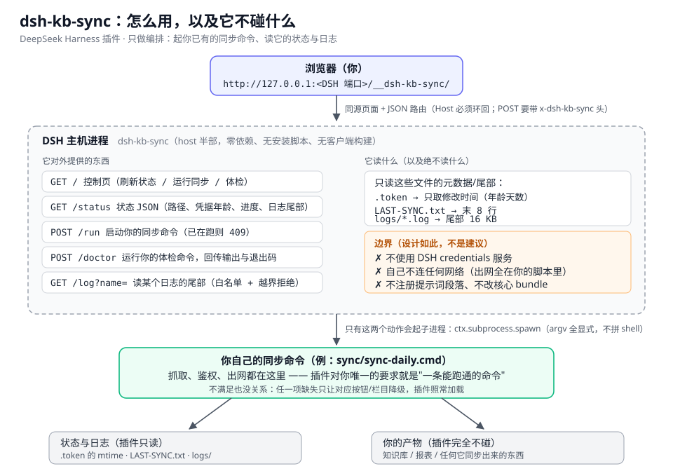
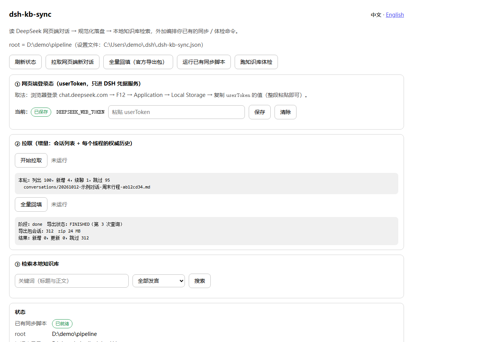

# dsh-kb-sync

[](https://github.com/284022719/dsh-kb-sync/actions/workflows/ci.yml)
[](LICENSE)
[](package.json)

A [DeepSeek Harness](https://github.com/deepseek-ai/deepseek-harness) plugin that brings **a conversation-sync pipeline you already own** onto one same-origin control page — run it, watch its state and logs, and check the knowledge base it produces.

The typical pipeline is "DeepSeek web history → local knowledge base", but the plugin does not care what you sync.

> **One plugin, three capability blocks.**
> **① Pull** — it reads the DeepSeek web `userToken` from the DSH credential service, calls chat.deepseek.com, normalizes conversations into a local knowledge base, and searches it in place. This block **reads a credential value and goes out to the network** (a red line for `dsh-trust-check`).
> **② Orchestrate** — it starts and monitors the sync / integrity command you already have, and reads its status files and logs. No credentials, no network.
> **③ Segment-2 judgement** — it runs the pipeline's judgement step in process: prepare inputs → one JSON judgement through the host `llm` service → validate → only then write and rebuild. No credentials; network goes through the host's `llm` adapter, so no domain is hard-coded here.
> None of the three injects prompt sections, overrides a core bundle, or ships an install script. Per-capability detail: [`docs/CAPABILITY-DISCLOSURE.md`](docs/CAPABILITY-DISCLOSURE.md).



<sub>⚠️ The diagram covers the **orchestration half only** (drawn at phase 1). The pull half and the organise step are not in it — see the route table below for those.</sub>

中文说明见 [`README.md`](README.md)；用户指南见 [`docs/USAGE.md`](docs/USAGE.md) / [`docs/USAGE.en.md`](docs/USAGE.en.md)；版本变更见 [`CHANGELOG.md`](CHANGELOG.md)。

## What it does / does not do



> Three more (the full page, a search hit, the English UI) live in [`assets/screenshots/`](assets/screenshots), listed by `screenshots.json`.
> Regenerate with `node tools/make-screenshots.mjs`: it serves a **fake-data-only** local demo and screenshots the real page, so the paths you see (`D:\demo\...`) and the conversations are invented — no data of yours is in the images.

| | |
|---|---|
| ✅ Does (orchestration) | Starts your configured command through DSH's `subprocess`; shows progress from your status files and logs; runs your integrity-check command; all from one local control page |
| ✅ Does (pull) | Calls chat.deepseek.com with the `userToken` from the DSH credential service: conversation list → only new / continued threads (the authoritative thread is located by walking `chat_session.current_message_id` up the parent chain) → `conversations/*.md` + `conversations.jsonl` + `catalog.json` → in-plugin search |
| ✅ Does (organise) | In-process judgement: prepare inputs → host `llm` returns one JSON → validate with the pipeline's own script → apply + rebuild. The default button is a dry run |
| ❌ Never | Writes the token to any file, log or response (it only lives in the credential service); contacts anything other than `chat.deepseek.com` **from the pull half** (segment 2 goes out through the host's `llm` adapter, whose domain the host configures); reads the contents of the expiring `.token` file (it only `stat`s its mtime); registers prompt sections; overrides a core bundle; ships an install script or runtime dependency |

## Requirements and install

A standard `dsh.bundle` plugin (host half, **zero runtime dependencies**, no client build step):

```sh
dsh plugin --profile <profile> add github:284022719/dsh-kb-sync
```

Then restart DSH. Requirements: DSH **0.2.0-rc.2 or newer** (it must provide the `webServer`, `subprocess`, `credentials` and `llm` services), Node ≥ 20.

> ⚠️ `file:` installs are **copied snapshots**: after changing the source, remove and re-add the bundle, then restart the app — the running instance keeps using the cached module (verified the hard way; see `docs/CAPABILITY-DISCLOSURE.md` §6).

## Configuration

The plugin never guesses your directories. With no configuration it still loads and the control page tells you exactly what is missing.

**Priority**: loader `config` → environment variables → user settings file → **`config.json` inside the plugin folder** → built-in defaults. Missing files and broken JSON are treated as empty (loading never fails); `/status` reports which sources were used in its `configFile` field.

| Channel | Where |
|---|---|
| Loader config | your profile's `cordis.patch.yml`, by plugin id |
| Environment | `DSH_KB_SYNC_ROOT`, `DSH_KB_SYNC_OUT_DIR`, `DSH_PIPELINE_DIR` |
| Settings file | `$DSH_HOME/.dsh-kb-sync.json` (or `~/.dsh/.dsh-kb-sync.json`) |
| Plugin folder | `<plugin>/config.json` — copy [`config.example.json`](config.example.json) and edit; config travels with the code |

Most-used keys: `root` (your pipeline root; `syncScript` / `logDir` / `lastSyncFile` / `tokenFile` are derived from it), `outDir` (knowledge base; defaults to `<plugin>/data/kb`), `tokenOldDays` (default 21), `chainMinIntervalMs` (freshness gate, default 6 h), `processProvider` / `processModel` / `processMaxTokens` (segment 2).

> ⚠️ **A restart is required after changing configuration** — settings are resolved once, when the plugin loads, and cached in memory.

## Usage

The page lives at **`http://127.0.0.1:<your DSH web port>/__dsh-kb-sync/`** (same port as the GUI).
**It is laid out by task — a one-line verdict bar, then Bring in new chats / Find content / Organise, with the heavy detail folded into "Run details & diagnostics"** (reworked 2026-10-15):

> You do not have to open the page: **Settings → dsh-kb-sync** in the app carries the same status summary (configuration, pipeline root, knowledge base, credential age, size, activity) and two actions — **Fetch new chats**, **Update knowledge base**. It deliberately has **no "open control page" button**: there should be exactly one answer to "where do I go" (on the author's machine that is the console's **Sync** tab, which embeds this very page). It follows the host UI language and deliberately offers **no config editing** (settings are resolved once when the plugin loads, so an editable form would lie until the next restart).

> **Language**: the control page is Chinese by default; `?lang=en` forces English, and without the parameter it follows the browser's `Accept-Language` (unknown languages fall back to Chinese). There is a switcher in the top-right corner. Chinese is the **source language** — the Chinese sentences in the page *are* the keys of the translation table (`locale/en.json`), and a missing translation falls back to the Chinese source, so adding a language never requires touching page code.

**The verdict bar (first screen)** — one sentence (fine / worth a look / last run failed) plus three key numbers (conversations in the KB, last update, sign-in age) and the **Update knowledge base** button. A "needs your attention" block appears only when there is something to do (sign-in getting old, last update failed, no root configured).

**Bring in new chats**
- *Fetch new chats (incremental)*: conversation list → only new / continued threads → markdown + JSONL + catalog; a continued thread is updated in place and keeps its filename.
- *Backfill full history* (folded away, only when needed): uses the official export package (`export_all` → poll until ready → download zip → parse `conversations.json`). It runs in the background and the page polls the progress every 3 s (`trigger → waiting-export → downloading → parsing → merging → done`).

**Find content** — by title and body, with an optional "user messages only" filter; every hit can be expanded to the full markdown of that conversation (thinking process and web-search records included).

**Organise (model classification & extraction)** — hands the newly fetched chats to the host model once (topic assignment, health facts, finance candidates):
- *Dry run (show what would change, write nothing)* — the default; prepare inputs → the host `llm` returns one JSON judgement → write `sync/out/` → validate with the pipeline's own `apply-extraction.mjs`.
- *Write and rebuild* — only after validation passes; rebuilds the knowledge base and the health profile.

The model only ever produces JSON and nothing lands before validation — deliberate: let the model edit `health/` or the finance ledger directly and a wrong number goes unnoticed.
(This step used to be called "segment 2" and ran inside a separate `dsh headless` runtime; it now calls the host model in-process and is called **Organise**.)

**Update knowledge base (the primary button)** — runs
**sign-in check → check for new content → fetch → organise → check-up** in order; every step's verdict,
exit code and duration lands in "Run details & diagnostics → Every step of the last update"
(the raw step ids `token/recon/fetch/process/doctor` live in the hover tooltip, for matching logs).
A failing row says why (`token-expired` / `failed` / `spawn-failed` / `finished-with-crash`).
The freshness gate returns `skipped` when the last success is less than `chainMinIntervalMs` ago; the page button passes `force:true` to bypass it.

**"Run details & diagnostics" also holds** the current status rows, knowledge-base size, the newest log tail, **Run check-up**, and **Run my configured sync script** (the orchestration half; the command comes from your config).

### Page layout conventions (reworked 2026-10-15 — do not roll this back)

- The first screen answers only "is it fine, and what do I press"; details live in `<details>`.
- Sections are grouped **by task** (bring in / find / organise / diagnose) and are **not numbered**
  (the old ①–⑤ carried no information and blurred what actually mattered).
- **No internal jargon in the UI**: segment 1 / segment 2 / full chain / phase 3 / dry-run / "landing" /
  `dsh headless` are developer-facing. The UI says fetch / organise / update / dry run / write.
  Two tests pin this (`test/locale.test.mjs` and `test/plugin.test.mjs`) — the jargon can't creep back.
- **One button per action**: previously the toolbar and the cards each had their own "pull" / "backfill".

**Manual vs scheduled trigger.** `tools/pipeline/trigger.cmd` only "pokes" the chain: it picks a usable `trigger-source.json`, waits for the host `/status`, then `POST`s `/pipeline` and appends each step's result to `trigger.log`. It orchestrates nothing itself. A Windows scheduled task is **optional**; with or without it the page buttons hit the same routes. Rebuild commands for the task are in [`tools/pipeline/README.md`](tools/pipeline/README.md) §3.

### Routes

| Route | Method | Purpose |
|---|---|---|
| `/__dsh-kb-sync/` | GET | Control page (single-file HTML, no external requests) |
| `/__dsh-kb-sync/status` | GET | Status JSON: paths, credential-file age, last status lines, newest log tail, fetch/backfill/organise/update progress |
| `/__dsh-kb-sync/pipeline` | POST | Update the knowledge base; `{"apply":true}` writes and rebuilds, `{"force":true}` skips the freshness gate |
| `/__dsh-kb-sync/token` | GET / POST | Query ("configured or not", **never the value**) / store the `userToken` |
| `/__dsh-kb-sync/token/clear` | POST | Forget the stored `userToken` |
| `/__dsh-kb-sync/pull` | POST | Incremental pull; returns this round's summary |
| `/__dsh-kb-sync/backfill` | POST | Start a full backfill; returns 202 immediately |
| `/__dsh-kb-sync/kb` | GET | Knowledge-base status (counts, size, last pull) |
| `/__dsh-kb-sync/search?q=&role=` | GET | Search; `role=user` restricts to user messages |
| `/__dsh-kb-sync/conversation?id=` | GET | One conversation as full markdown (>400 KB is truncated and flagged) |
| `/__dsh-kb-sync/run` | POST | Start your sync command; 409 while one is running |
| `/__dsh-kb-sync/process` | POST | Organise (model judgement); validation only by default, `{"apply":true}` writes and rebuilds; 409 while running |
| `/__dsh-kb-sync/doctor` | POST | Run your integrity-check command; returns stdout / stderr / exit code |
| `/__dsh-kb-sync/log?name=` | GET | Tail one log file below the log directory (name allowlist + traversal refusal) |

## Security model

- **Loopback only**: `Host` must be `127.0.0.1` / `localhost` / `::1` (blocks DNS rebinding); a non-same-origin `Sec-Fetch-Site` is rejected with 403.
- **Writes need a custom header**: POSTs must carry `x-dsh-kb-sync: 1` (cross-site forms cannot set custom headers).
- **Log reads are allowlisted**: `^[A-Za-z0-9._-]{1,120}$`, and the resolved path must stay inside the log directory.
- **Explicit argv**: `cmd.exe /c <script>` (or `/bin/sh` on POSIX) — no shell string interpolation.
- **The credential file is only `stat`ed**: status carries existence, mtime and age; its contents never enter a response (covered by a unit test).
- **The token is never written**: not to files, logs or responses; error text is redacted.

## Capability disclosure (`dsh-trust-check`)

Static, reproducible, zero-token — **1 red line**:

```
1 plugin(s) · 1 red · 0 accepted · 0 review · 0 expected · 0 clear
dsh-kb-sync 0.1.0 — red
  why be careful: reads credential values and has network access; may touch secrets or sensitive env vars; execute system commands
  capabilities: shell, fs-write, fs-read, network (outbound), credentials, env
  secret touches: read: creds.resolve(
  injections: 1 item(s)
    client-inject: @deepseek-ai/dsh-client-locale, @deepseek-ai/dsh-client-ui-settings
```

Read it like this: the red line is the *necessary* consequence of the pull half (resolve the token, then send it to chat.deepseek.com). It cannot be removed by editing code — only bounded: the token goes into the credential service only, is used for that one request, and never reaches a file, log or response; the pull half's only outbound host is `chat.deepseek.com`. Per the tool's rules a red line is blocked by default: to keep using the plugin you confirm the risk in **Settings → plugin check** (the fingerprint changes with the code, so it must be confirmed again). Not being flagged is not proof of safety — see [`docs/CAPABILITY-DISCLOSURE.md`](docs/CAPABILITY-DISCLOSURE.md).

## Known limitations

- **One in-app surface, not a full settings page**: `lib/client.js` registers a **Settings → dsh-kb-sync** section (a few status rows plus Fetch new chats / Update knowledge base / Refresh). It is hand-written with no build step, and it does **not** edit configuration. The full control page (search, reading a conversation in place, the per-step table) is still its own URL. The assembly contract is checked item by item against the host implementation (the `__ModuleLoader__.load` id must equal the package name, the accepted forms of `exports["./client"]`, the `settings.section` registration fields, `immediately` being a prefetch hint only) — see [`docs/CLIENT-HALF.md`](docs/CLIENT-HALF.md) and the whole install chain (`insert` row → loader specifier → package dir → both halves) in [`docs/INSTALL-PATH.md`](docs/INSTALL-PATH.md).
- **The control page and the in-app section both ship Chinese and English**: the page defaults to Chinese and switches via `?lang=en` or `Accept-Language`; the settings section follows the host locale. **Server-side diagnostics stay Chinese** (`/status` messages, per-stage chain output, the pipeline's own script output) — they are troubleshooting text, not worth translating yet.
- Requires the host's `subprocess` service; when missing, `/run` and `/doctor` say so explicitly instead of failing silently.
- State is polled (every 3 s while something runs), not pushed.
- **Incremental pull can only ever see the newest 100 conversations**: the list endpoint caps `count` at 100 and ignores paging parameters (verified 2026-10-12: `count=101` → `ILLEGAL_COUNT`; `page` / `offset` / `seq_id` / `cursor` ignored; `POST` → 405). Complete history comes from the full backfill.
- Verified on Windows + DSH 0.2.0-rc.2: control page, `/status`, `/doctor`, out-of-bounds and cross-site refusal, the update flow / the organise step / the full backfill from the page. The POSIX execution branch is written but **not** tested on a real POSIX host.
- `userToken` expires (hours to days): pulls then fail and you paste a new one. It is your account credential — do not share it.
- By default the plugin does not share a knowledge-base directory: its library lives in its own `data/kb`. Only if you point `outDir` at a directory another script also writes will the two rewrite `catalog.json` / `conversations.jsonl` under each other (read-modify-write).
- Search scans the JSONL directly with no index — fine for a few thousand conversations, not for ten times that.

## Development

```sh
npm test        # node --test: 91 cases (routes, same-origin guard, traversal refusal, argv, credential never read, timestamps, language wiring, client-half contract, translation-table integrity, doc consistency)
npm run check   # syntax-check every lib file + an ESM import smoke test
npm run check:types  # tsc --noEmit over lib/index.d.ts + types/usage.ts (needs npm install; dev only)
npm run pack:check
npm run preflight   # release preflight: tests + syntax + types + package contents + capability disclosure
```

## License

MIT
